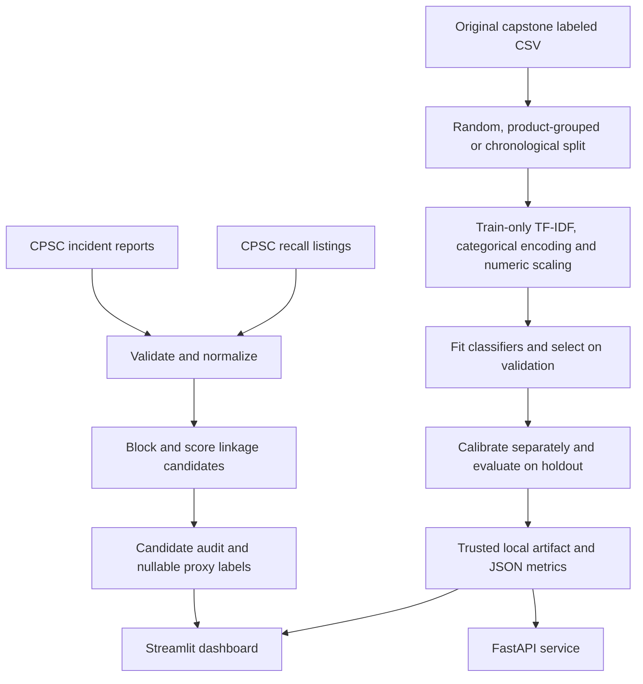
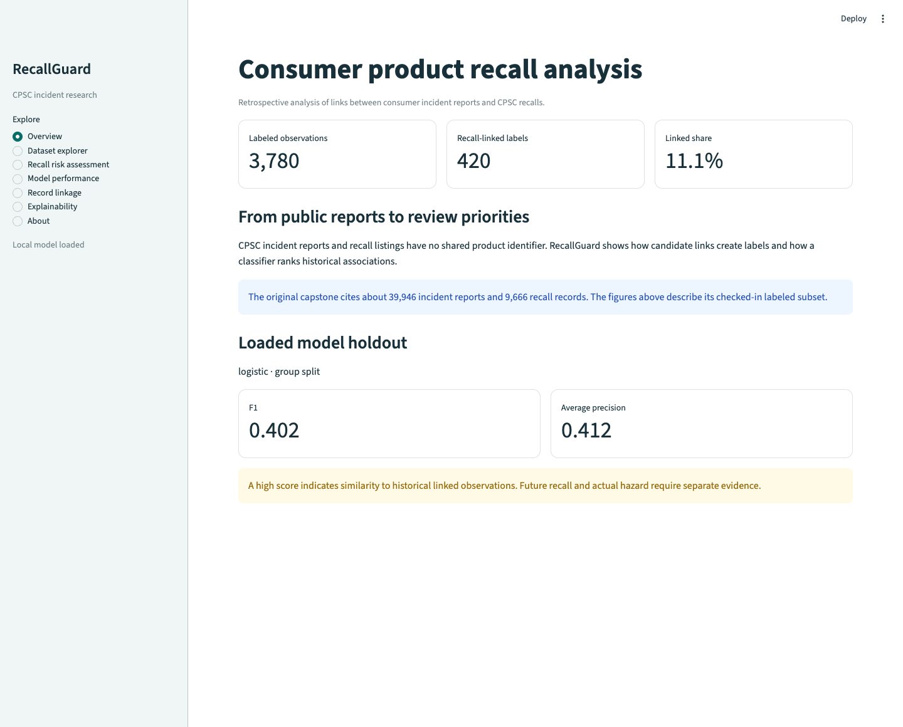

# RecallGuard

**Consumer Product Recall Risk Analysis Using NLP, Machine Learning, and Record Linkage**

CPSC incident reports and official recall listings lack a shared product identifier. RecallGuard builds auditable candidate links between the two sources, then uses the original capstone's labeled dataset to test how well NLP classifiers rank retrospective recall associations. The project includes an offline training CLI, a Streamlit dashboard, and a FastAPI service.

## Technologies and dataset

RecallGuard uses Python, pandas, scikit-learn, XGBoost, Streamlit, and FastAPI. The repository includes a Docker configuration and GitHub Actions checks.

The source data comes from U.S. Consumer Product Safety Commission (CPSC) consumer incident reports and official recall listings. The [historical capstone CSV](data/training_data.csv) contains 3,780 labeled incident reports, including 420 linked to recalls. The record-linkage workflow accepts separate raw CPSC exports and produces candidate links for review. See the [data pipeline](docs/DATA_PIPELINE.md) for input schemas and label construction.

## Verified benchmark

The 3,780-row capstone dataset includes 420 linked incidents. With seed 42, each model was selected by validation average precision (AP), then scored on a held-out test partition.

| Holdout | Validation-selected model | Test AP | Test F1 |
| --- | --- | ---: | ---: |
| Random rows | Logistic regression | 0.551 | 0.562 |
| Product groups | Logistic regression | 0.412 | 0.402 |
| Chronological, with product-group purging | XGBoost | 0.144 | 0.019 |

The chronological AP baseline was 0.128. That model recovered one of 97 linked test reports at its validation threshold. The evaluation supports retrospective association analysis and shows weak transfer to newer reports. It provides no evidence of validated prospective early warning. See the [evaluation](docs/MODEL_EVALUATION.md) and [machine-readable benchmark](results/metrics/historical_proxy_benchmark.json).

The original Spring 2026 capstone reported Linear SVM F1 **0.688** and Home Maintenance and Structures F1 **0.784**. These figures are preserved as historical results with their original slides and README. [Capstone slides](presentations/recallguard-capstone.pdf) · [Historical README](docs/CAPSTONE_README.md) · [Original app screenshots](screenshots/capstone-dashboard.pdf)

## Quick start

Run the commands from the repository root using Python 3.11 or later. On systems where XGBoost requires OpenMP, make the platform's OpenMP runtime available (for example, `brew install libomp` on macOS).

```bash
python3 -m venv .venv
source .venv/bin/activate
python -m pip install -r requirements-dev.txt -e .
pytest -q

streamlit run app.py
```

The dashboard starts without a model and exposes the historical dataset and a synthetic linkage example. To run the dashboard with an existing trusted bundle, set `RECALLGUARD_MODEL` to its path.

```bash
RECALLGUARD_MODEL=results/runs/group.joblib streamlit run app.py
```

To reproduce the full benchmark, run `recallguard train --design all`. The CLI resolves the bundled dataset at `data/training_data.csv` when the working directory has no legacy `training_data.csv`. Use `--data` to select another CSV. See the [deployment guide](docs/DEPLOYMENT.md) for Docker and API setup.

## Repository structure

| Path | Contents |
| --- | --- |
| `app.py` | Streamlit entry point |
| `src/recallguard/` | FastAPI, CLI, record linkage, training, evaluation, and inference |
| `data/` | Historical capstone dataset and data layout guide |
| `models/` | Model bundle guide |
| `results/metrics/` | Recorded benchmark results |
| `docs/` | Technical documentation and archived capstone README |
| `screenshots/` | Current dashboard screenshots and historical screenshots |
| `presentations/` | Capstone slides |
| `tests/` | Existing tests |
| `Dockerfile`, `.github/workflows/` | Container and CI configuration |

## Architecture



The reconstructed linker combines rare-token blocking with exact model codes and checksum-valid UPC/GTINs extracted from recall listings. A replay recovered 204 of 207 date-eligible links from the earlier match audit, up from 170 with text-only blocking. The full run identified 146 unique high-confidence proxy labels, up from four. These measure coverage and heuristic yield. The historical CSV supplies the supervised benchmark while reconstructed links await adjudication. [Data pipeline](docs/DATA_PIPELINE.md) · [Linkage benchmark](results/metrics/linkage_reference_benchmark.json) · [Scientific validity](docs/SCIENTIFIC_VALIDITY.md)

Models compare sparse word and character TF-IDF, optional structured product fields, and incident text length using pandas, scikit-learn, and XGBoost. The benchmark includes a dummy prior, logistic regression, Linear SVM, Complement NB, and XGBoost. Each run records its data fingerprint, chosen model, threshold, metrics and environment versions.

## Dashboard



[Model performance screen](screenshots/model-performance.png)

## API

```bash
RECALLGUARD_MODEL=results/runs/group.joblib uvicorn recallguard.api:app
curl http://127.0.0.1:8000/health
curl http://127.0.0.1:8000/model-info
curl -X POST http://127.0.0.1:8000/predict \
  -H 'Content-Type: application/json' \
  -d '{"product":"Electric kettle","description":"The switch stuck and the base overheated.","category":"Kitchen"}'
```

`/docs` serves the interactive API reference. The score and feature contributions reflect the fitted proxy model. See the [API examples and Docker instructions](docs/DEPLOYMENT.md).

## Limitations

Historical labels depend on record linkage and a sampled dataset. The chronological evaluation showed weak transfer, and the model score measures association with historical linkage labels. See the [limitations](docs/LIMITATIONS.md), [scientific validity notes](docs/SCIENTIFIC_VALIDITY.md), and [chronological evaluation](docs/MODEL_EVALUATION.md#chronological-generalization-follow-up).

## Research context

Youssef Rafik · B.S. Data Science capstone · Southern Connecticut State University · Spring 2026. The original capstone investigated whether consumer incident reports can identify products associated with recalls. The portfolio upgrade adds an auditable reconstruction, separate model development and testing, artifact-backed serving, and local verification.

[Public CPSC data](https://www.cpsc.gov/Data) · [Repository audit](docs/REPOSITORY_AUDIT.md) · [Implementation report](docs/IMPLEMENTATION_SUMMARY.md) · [MIT license](LICENSE)
