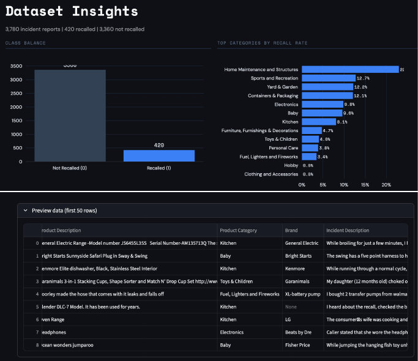
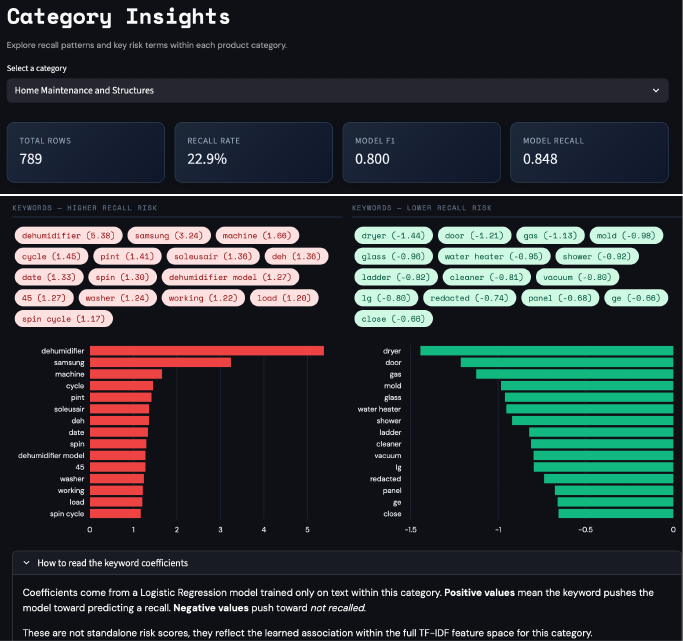
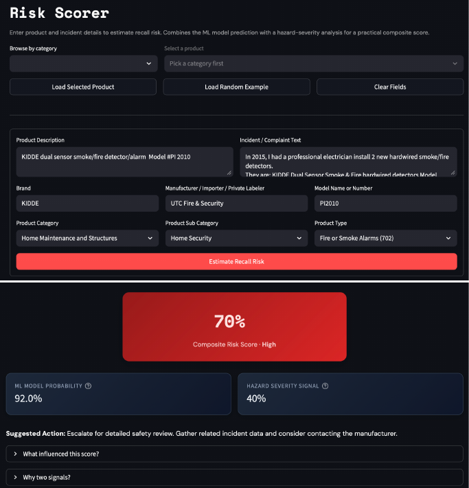
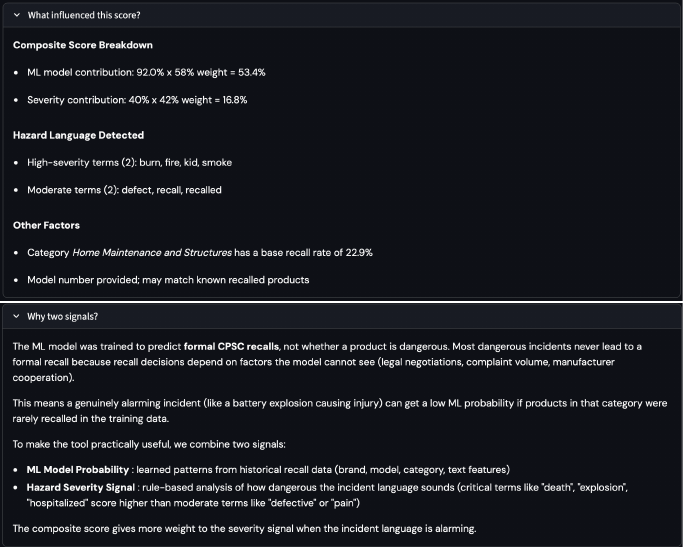
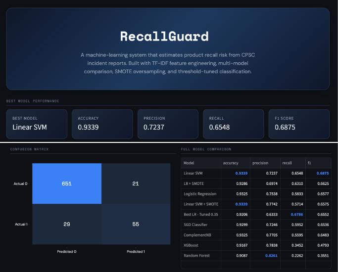
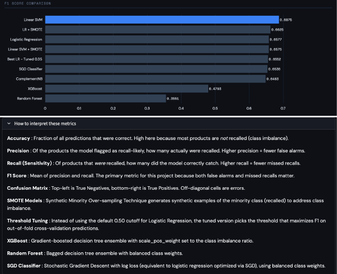

# RecallGuard

RecallGuard studies whether the text and product details in consumer safety complaints are associated with historical U.S. Consumer Product Safety Commission (CPSC) recalls. This is the original Data Science capstone by **Youssef Rafik**, Southern Connecticut State University, Spring 2026. [RecallGuard V2](https://github.com/youssefrafik6/RecallGuard-V2) extends the research with candidate review, more rigorous grouped and chronological evaluation, and versioned model serving.

## Data and historical research

The capstone linked SaferProducts.gov consumer incident reports to CPSC recall listings. The files lack a shared product identifier, so the study normalized product fields and combined model, UPC, brand, manufacturer, category, product-code, token-overlap, and fuzzy-text evidence to assign candidate matches and confidence levels. The app starts from the [bundled labeled CSV](data/training_data.csv), containing 3,780 incident reports and 420 positive linkage labels.

The models use word and character TF-IDF, encoded product fields, and numeric text features. The capstone compared linear models, naive Bayes, tree ensembles, oversampling, and category-specific models. The **historical capstone F1** was **0.688** for the general Linear SVM and **0.784** for Home Maintenance and Structures. These figures come from the original research.

## Run the app

Python 3.11 is recommended. From the repository root, run:

```bash
python3.11 -m venv .venv
source .venv/bin/activate
python -m pip install -r requirements.txt
python -m streamlit run app.py
```

You can also launch `python -m streamlit run app/streamlit_app.py`.

**Dataset Insights** summarizes the linkage labels. **Category Insights** displays development-fold metrics and text associations. **Model Details** shows the historical results and the recorded random and grouped benchmarks. **Risk Scorer** loads examples or accepts a new report and combines the historical logistic regression association signal with fixed severity rules. The resulting 0–1 Combined Review Priority Score is for exploratory triage. Official safety assessments come from the CPSC.

Category Insights and Risk Scorer share a logistic regression fit, cached in the Streamlit process. For a live demo, submit a Risk Scorer example before presenting to warm the model. Model Details reads the recorded benchmark so opening the dashboard does not run the full experiment.

## Streamlit Community Cloud deployment

In [Streamlit Community Cloud](https://share.streamlit.io/), choose **Create app** and deploy from GitHub. Use repository `youssefrafik6/RecallGuard`, branch `main`, and entry point `app.py`. Select Python 3.11 in Advanced settings and leave Secrets empty. After deploying, check that the app opens in a private browser window, then test each dashboard page and submit a Risk Scorer example. The first use of Risk Scorer or Category Insights fits the shared model and can take longer on free hosting.

## Reproduce the retrospective evaluation

```bash
python app/evaluation.py --audit-only
python -m pip install -r requirements-evaluation.txt
python app/evaluation.py
python -m pip install pytest
python -m pytest
```

On macOS, the full benchmark also needs the OpenMP runtime for XGBoost (`brew install libomp` on Homebrew).

The original stratified random split and a related-report grouped split use the same candidate search. Each selects the classifier, hyperparameters, and any tuned cutoff using its own five development folds. Its holdout is used once to score the frozen winner per run. The [evaluation report](EVALUATION.md) describes the split audit, comparison, and limitations.

Both holdouts come from the same historical capstone sample, and the original random holdout informed earlier development. Positive labels depend on imperfect links to recalls, unlinked cases can include missed matches, and the sampled class balance limits interpretation of scores. The grouped split tests sensitivity to measured relatedness. Estimating the chance of a future recall would require independent, chronological or prospective validation and calibration.

## Dashboard screenshots

These captures show the original capstone dashboard. See the [evaluation report](EVALUATION.md) for the current benchmark and the app for the current scoring labels.

### Dataset Insights



### Category Insights



### Risk Scorer





### Model Details





[MIT License](LICENSE)
