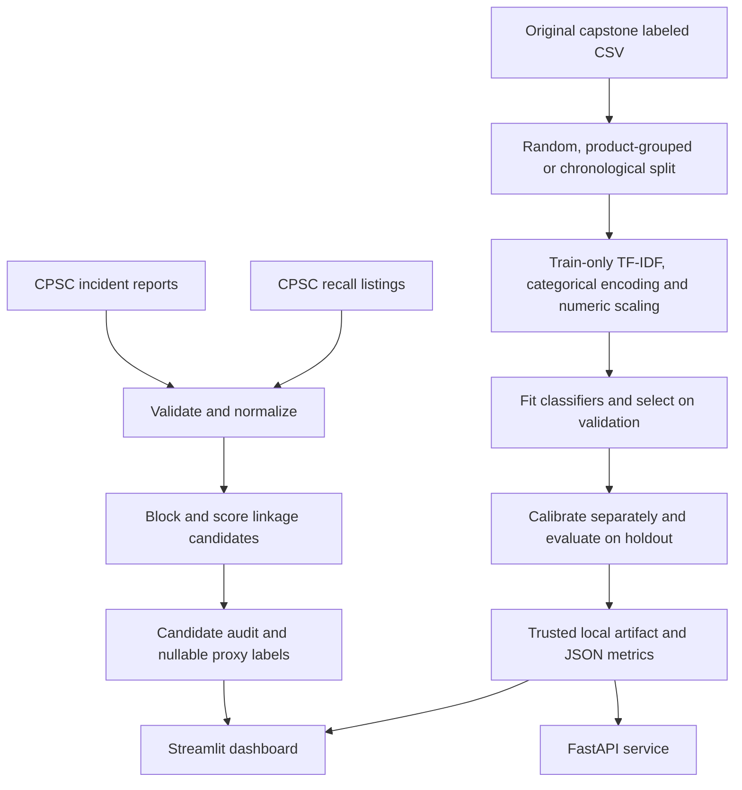

# RecallGuard

**Consumer Product Recall Risk Analysis Using NLP, Machine Learning, and Record Linkage**

CPSC incident reports and official recall listings lack a shared product identifier. RecallGuard builds auditable candidate links between the two sources, then uses the original capstone's labeled dataset to test how well NLP classifiers rank retrospective recall associations. The project includes an offline training CLI, a Streamlit dashboard, and a FastAPI service.

## Verified benchmark

The 3,780-row capstone dataset includes 420 linked incidents. With seed 42, each model was selected by validation average precision (AP), then scored on a held-out test partition.

| Holdout | Validation-selected model | Test AP | Test F1 |
| --- | --- | ---: | ---: |
| Random rows | Logistic regression | 0.551 | 0.562 |
| Product groups | Logistic regression | 0.412 | 0.402 |
| Chronological, with product-group purging | XGBoost | 0.144 | 0.019 |

The chronological AP baseline was 0.128. That model recovered one of 97 linked test reports at its validation threshold. The evaluation supports retrospective association analysis and shows weak transfer to newer reports. It provides no evidence of validated prospective early warning. See the [evaluation](docs/MODEL_EVALUATION.md) and [machine-readable benchmark](results/metrics/historical_proxy_benchmark.json).

The original Spring 2026 capstone reported Linear SVM F1 **0.688** and Home Maintenance and Structures F1 **0.784**. These figures are preserved as historical results with their original slides and README. [Capstone slides](Slides/RecallGuard_Capstone_Project.pdf) · [Historical README](docs/CAPSTONE_README.md) · [Original app screenshots](screenshots/screenshots.pdf)

## Quick start

Use Python 3.11 or later. On systems where XGBoost requires OpenMP, make the platform's OpenMP runtime available (for example, `brew install libomp` on macOS).

```bash
python3 -m venv .venv
source .venv/bin/activate
python -m pip install -r requirements-dev.txt -e .
pytest -q

# Full benchmark across random, grouped and chronological designs
recallguard train --design all

# Start the app with the grouped research model
RECALLGUARD_MODEL=results/runs/group.joblib streamlit run app.py
```

The dashboard starts without a model and exposes the historical dataset and a synthetic linkage example. To generate a lightweight bundle for a smoke check, run `recallguard train --design group --smoke --out results/runs/smoke`. It has its own artifact path and a smaller estimator suite.

## Architecture



The reconstructed linker bounds candidate expansion through rare product and manufacturer tokens and scores product-name overlap, fuzzy similarity, and manufacturer or brand agreement. Date and ambiguity checks protect the proxy label. Four incidents met the unique high-confidence rule on the available local exports. Unresolved incidents remain unlabeled. The historical CSV supplies the supervised benchmark while these reconstructed links await adjudication. [Data pipeline](docs/DATA_PIPELINE.md) · [Scientific validity](docs/SCIENTIFIC_VALIDITY.md)

Models compare sparse word and character TF-IDF, optional structured product fields, and incident text length using pandas, scikit-learn, and XGBoost. The benchmark includes a dummy prior, logistic regression, Linear SVM, Complement NB, and XGBoost. Each run records its data fingerprint, chosen model, threshold, metrics and environment versions.

## Dashboard


[Model performance screen](screenshots/model-performance.png)

## API

```bash
RECALLGUARD_MODEL=results/runs/group.joblib uvicorn recallguard.api:app
curl http://127.0.0.1:8000/health
curl http://127.0.0.1:8000/model-info
curl -X POST http://127.0.0.1:8000/predict \
  -H 'Content-Type: application/json' \
  -d '{"product":"Electric kettle","description":"The switch stuck and the base overheated.","category":"Kitchen"}'
```

`/docs` serves the interactive API reference. The score and feature contributions reflect the fitted proxy model. See the [API examples and Docker instructions](docs/DEPLOYMENT.md).

## Research context

Youssef Rafik · B.S. Data Science capstone · Southern Connecticut State University · Spring 2026. The original capstone investigated whether consumer incident reports can identify products associated with recalls. The portfolio upgrade adds an auditable reconstruction, separate model development and testing, artifact-backed serving, and local verification.

[Public CPSC data](https://www.cpsc.gov/Data) · [Repository audit](docs/REPOSITORY_AUDIT.md) · [Limitations](docs/LIMITATIONS.md) · [Implementation report](docs/IMPLEMENTATION_SUMMARY.md) · [MIT license](LICENSE)
